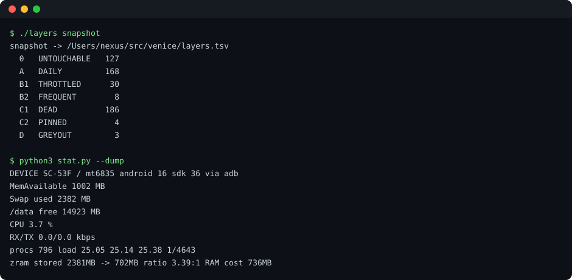

# layerctl

**Non-root Android app-standby layer switchboard.** Re-map every installed
package into 7 tiers, then apply only the diff. No root. No ROM.

非root Android のアプリ層スイッチボード。端末の全パッケージを7つの層に分類して
`layers.tsv` に固定し、**現在状態との差分だけ**を適用する。適用のたびに前後8秒の
メモリ差分を自動表示する。

輸送層は `core.detect()` が **rish(Shizuku) / adb / su** から自動選択する。
端末上の Termux でも、PC から USB 経由の adb でも、同じコマンドが等価に動く。

## アーキテクチャ

~~~mermaid
flowchart LR
  subgraph host["ホスト: Termux / macOS / Linux"]
    TUI["tui.py 層スイッチボード"]
    STAT["stat.py ライブダッシュボード"]
    CORE["core.py detect / snapshot / rates"]
    PROF["profiles/ 端末固有データ + QUIRKS"]
  end
  subgraph dev["Android 端末 (非root)"]
    RISH["rish (Shizuku)"]
    ADB["adbd (USB)"]
    SU["su (任意)"]
    SH["/system/bin/sh uid 2000"]
  end
  TUI --> CORE
  STAT --> CORE
  TUI --> PROF
  CORE -->|自動選択| RISH
  CORE -->|自動選択| ADB
  CORE -->|自動選択| SU
  RISH --> SH
  ADB --> SH
  SU --> SH
  SH --> API["pm / cmd appops / dumpsys / deviceidle"]
~~~

本体は端末を知らない。輸送層とプロファイルの両方が差し替え可能で、
`tui.py` と `stat.py` は `core` の口だけを見る。

## なぜ差分計測なのか

非root では `dmesg` も LMKD のログも読めない。プロセスが何MB解放されたかを
知る手段が無い。**だから適用前後の差分が唯一の物証になる。**
この道具は叩くたびに自分の効果を数字で報告する。

実測例（SC-53F / 4GB機）:

| 対象 | MemAvailable | procs |
|---|---|---|
| 全体 re-assert (5 cmd) | **+82.1 MB** | −2 |
| 仮想通貨アプリ1本を C1 へ | **+276.3 MB** | −10 |

## 層モデル

| 層 | 名前 | 意味 | 適用コマンド | 持続性 |
|---|---|---|---|---|
| 0 | untouchable | 不可侵 / Doze 保護 | `dumpsys deviceidle whitelist +` | 持続 |
| A | daily | 常用 | `cmd appops set ... allow` | 揮発 |
| B1 | throttled | 通知遅延可 | `appops ignore` + `bucket restricted` | 揮発 |
| B2 | frequent | 通知維持 | `appops allow` + `bucket frequent` | 揮発 |
| C1 | dead | 無効化 | `pm disable-user --user 0` | 持続 |
| C2 | pinned | 殺せないので縛る | `appops ignore` + `bucket restricted` | 揮発 |
| D | greyout | 手が届かない（root 必須） | — | 対象外 |

`0` と `C1` は `pm disable-user` と `deviceidle whitelist` で書かれるため
**OTA 以外で崩れない**。`A` `B1` `B2` `C2` は bucket 系で**揮発する**。
だから `--reapply` は収束演算ではなく**再主張**であり、残差は常に数本残って振動する。

## 必要環境

- Android 11 以上
- `python3`（標準ライブラリのみ。依存なし）
- 輸送層のいずれか:
  - `rish`（Shizuku を起動し `~/rish` に配置 + `chmod +x`）— 端末上で完結
  - `adb`（USB デバッグ）— PC から。`ANDROID_SERIAL` でデバイスを固定
- root 不要

## 使い方

~~~
./layers profile     # 使用中のプロファイルと能力検出を表示
./layers snapshot    # 現状を走査して layers.observed.tsv に記録（layers.tsv は不変）
./layers seed        # 観測を layers.tsv（意志）へ昇格
./layers diff        # 意志と観測のズレだけ表示
./layers plan        # 差分コマンドだけ抽出。実行しない
./layers apply       # 差分を適用し、8秒後のメモリ差分を表示
./layers reapply     # 全件を再主張（OTA 後の復旧用）
./layers             # TUI
~~~

`layers.tsv` は**意志**（望む層）、`layers.observed.tsv` は**観測**。`snapshot` は観測を
更新するだけで意志を壊さない。意志を観測へ合わせたい時だけ `seed` を打つ。

ライブダッシュボード:

~~~
python3 stat.py          # curses。メモリ / swap / CPU / RX / TX をスパークライン表示
python3 stat.py --dump   # 1フレームを素テキストで（CI / 検品用）
~~~

TUI の操作:

| キー | 動作 |
|---|---|
| `j` `k` | 上下移動 |
| `tab` | 層パネル / パッケージパネルの切替 |
| `space` | 層を巡回（0→A→B1→B2→C1→C2→D→0） |
| `a` | 選択中の1本を適用（risk>=3 は `y` 確認） |
| `A` | staged 全件を一括適用 |
| `w` | layers.tsv に保存 |
| `R` | 全件を再主張 |
| `q` | 保存して終了 |

## 移植

端末固有データは **`profiles/` の1ファイルだけ**に入っている。`tui.py` 本体は
端末を知らない。輸送層も `core.detect()` に閉じている。

~~~
cp profiles/generic.py profiles/pixel9.py
# NAME / MATCH_MODEL / MATCH_PLATFORM / D_HARD / C2_HARD / L0_HARD / IMPACT を書く
~~~

`ro.product.model` か `ro.board.platform` が一致すれば自動で選ばれる。外れれば
`generic` に落ちる。輸送層は `VENICE_TRANSPORT=adb` で明示固定できる。

## 実測で確定した地雷

| 症状 | 真因 | 対処 |
|---|---|---|
| 出力が全部空になる | `rish` が stdout/stderr を気まぐれに振り分ける | 常に `2>&1` |
| スクリプトが途中で止まる | `rish` が stdin を飲み尽くす | 常に `</dev/null` |
| `timeout` でハングする | 非前景プロセスグループで SIGTTOU | `timeout --foreground` |
| `adb shell` が `\r\n` を混ぜる | PTY 経由 | `adb exec-out` + `\r` 除去 |
| `dumpsys euicc` が無い | 正は `dumpsys econtroller` | QUIRKS に記録 |
| `/proc/swaps` が Permission denied | `dumpsys meminfo` の ZRAM 行で代用 | — |

## 既知の限界

- bucket 系の層は揮発する。システムが予測・時間切れ・利用検知で書き戻す
- 保護パッケージ（fmm / kgclient / knox.cloudmdm）は `restricted` を保持しない
- `EXEMPTED` は doze whitelist と同義ではない
- OTA は `appops` をリセットする。`--reapply` で復旧する
- `layers.tsv` は**意志**。`snapshot` は書き換えず、観測は `layers.observed.tsv` に隔離される

## License

MIT
